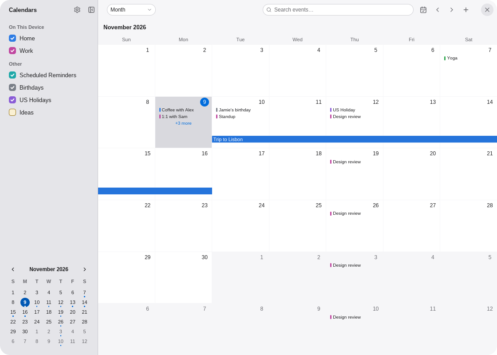
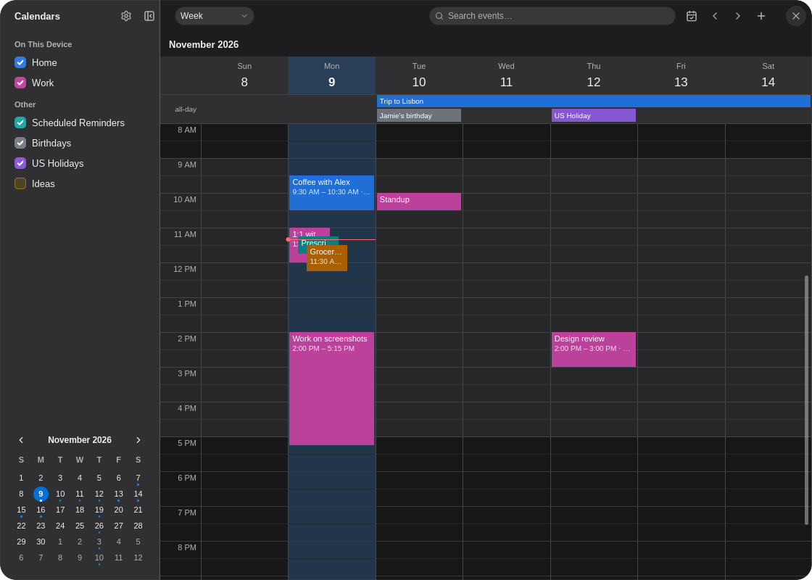
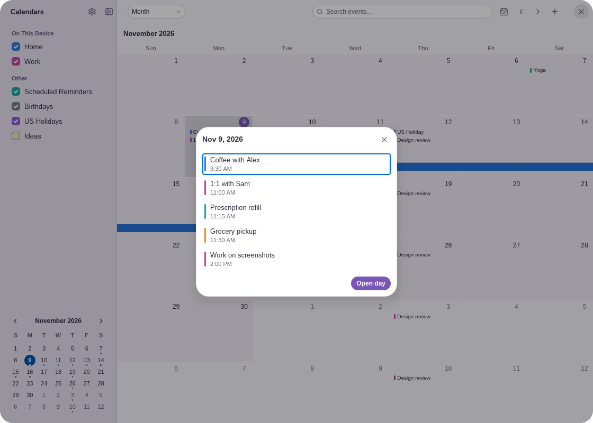
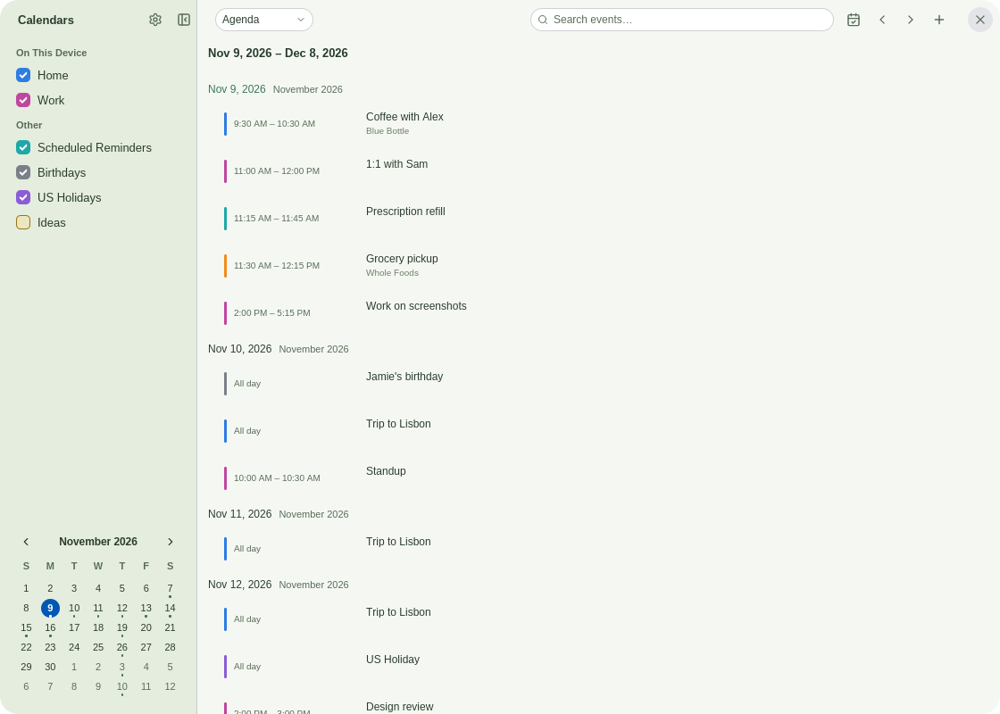
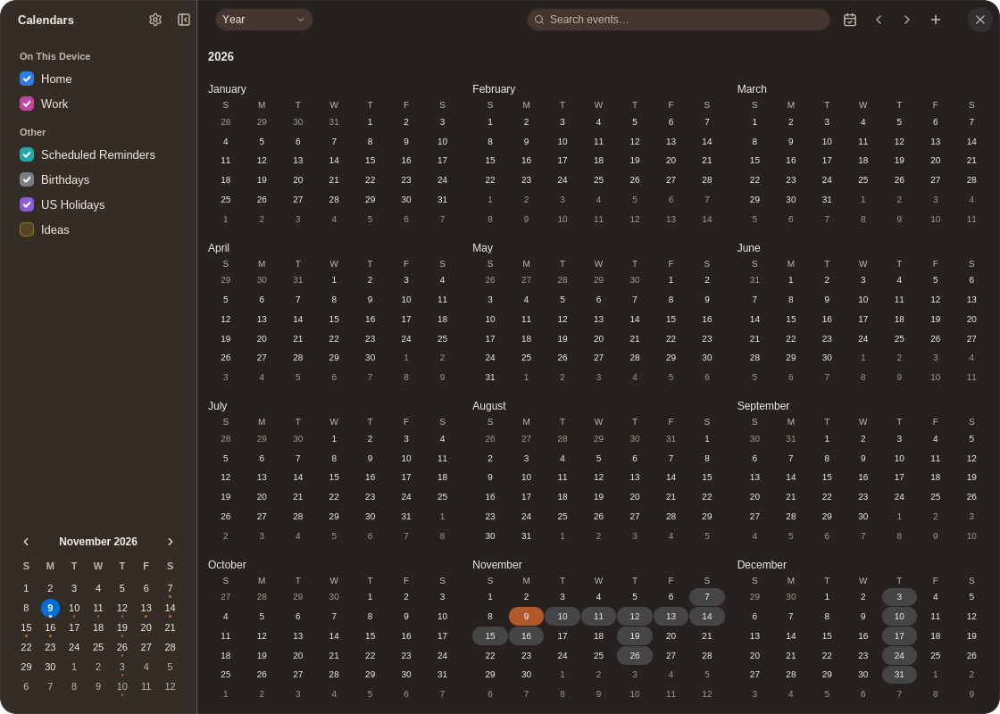
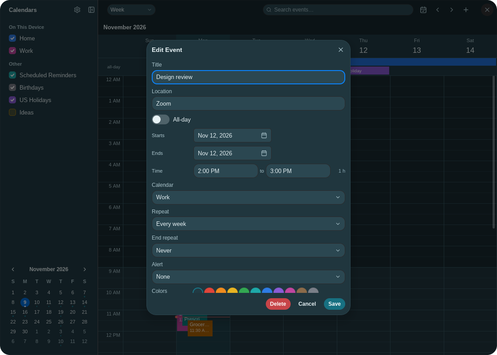
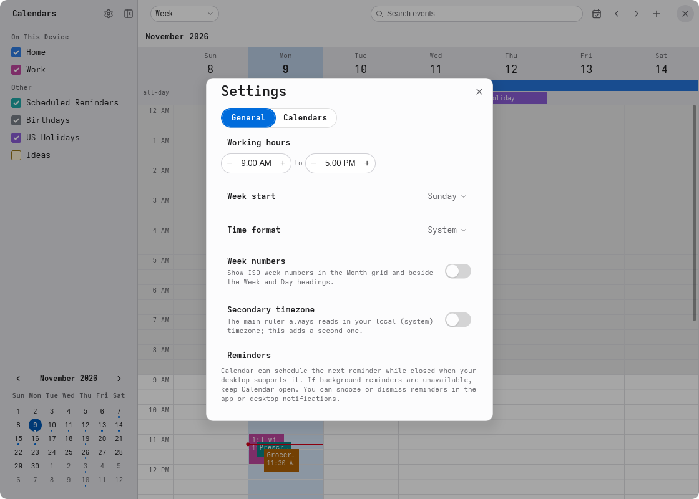
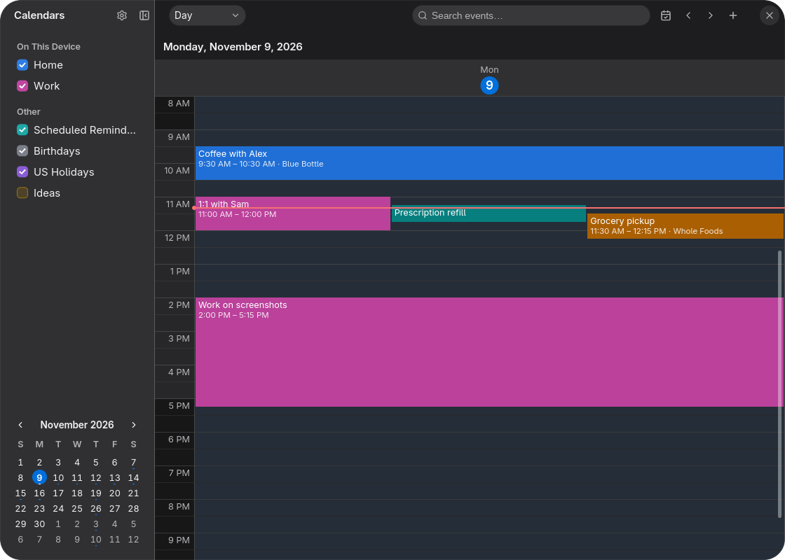

# Calendar

Manage local events, schedules and reminders. Built with [enzUI](https://github.com/enz1m/enzui).

<table>
  <tr>
    <td align="center"><a href="docs/screenshots/basic-light.png"></a><br><sub>Month · light</sub></td>
    <td align="center"><a href="docs/screenshots/basic-dark.png"></a><br><sub>Week · dark</sub></td>
    <td align="center"><a href="docs/screenshots/lavender.png"></a><br><sub>Day events</sub></td>
    <td align="center"><a href="docs/screenshots/sage.png"></a><br><sub>Agenda</sub></td>
  </tr>
  <tr>
    <td align="center"><a href="docs/screenshots/ember.png"></a><br><sub>Year</sub></td>
    <td align="center"><a href="docs/screenshots/lagoon.png"></a><br><sub>Repeating event</sub></td>
    <td align="center"><a href="docs/screenshots/precision.png"></a><br><sub>Preferences</sub></td>
    <td align="center"><a href="docs/screenshots/comfort.png"></a><br><sub>Day</sub></td>
  </tr>
</table>

Click a screenshot to enlarge. Images use isolated example data and shared enzUI themes.

## Features

- Day, week, month, year and agenda views with searchable events.
- Multiple local calendars, recurring events and reminders.
- Import and export iCalendar files; drag events between applications.

## Build and run

Use Rust **1.99.1** (minimum **1.95**), a C/C++ toolchain and pkg-config.
Linux UI builds need Wayland/XKB, GLib/GIO, fontconfig and Vulkan/EGL development support.

```sh
git clone https://github.com/enz1m/calendar.git
cd calendar
cargo fetch --locked
cargo build --locked
cargo run --locked
```

Dependencies pin public [enzUI Alpha 0.2](https://github.com/enz1m/enzui/releases/tag/v0.2.0-alpha.1)
and its matching public foundation forks. No sibling framework checkout is needed.
Wayland is enabled by default; use `--features x11` when X11 support is needed.
Use `cargo build --release --locked` for an optimized binary.

## Files and desktop integration

Open `.ics` files to import events; exported iCalendar files work with other calendar applications.

## Requirements and limits

Calendar stores its own local calendars. Seasonal VTIMEZONE and recurring remote-zone imports are refused rather than silently converted. Reminder delivery requires a running desktop session. Native installs can use
the framework’s user-systemd scheduler while Calendar is closed. Sandboxed builds,
including Flatpak, currently deliver reminders only while Calendar is open;
closed-app scheduling through an approved background process is not implemented.
No host filesystem or systemd permissions should be added to bypass this limit.

Shared enzUI theme settings apply live. Translations are under `assets/locales`;
locale coverage varies.

## Development

```sh
cargo fmt --all -- --check
ICED_TEST_BACKEND=software cargo test --locked --all-targets -- --test-threads=1
cargo clippy --locked --all-targets -- -D warnings
```

Reminder integration tests require Python 3, Bubblewrap, `dbus-daemon` and the
`America/New_York` timezone data. These are test fixtures; the application does
not require Python. See [isolated reminder checks](tests/fixtures/reminder_activation/README.md).

Keep tests for durable workflows, data integrity, resource ownership and security
boundaries. See [contributing](CONTRIBUTING.md).

Licensed under [MIT](LICENSE). See [third-party notices](THIRD_PARTY.md) for
dependency and test-renderer attribution.
